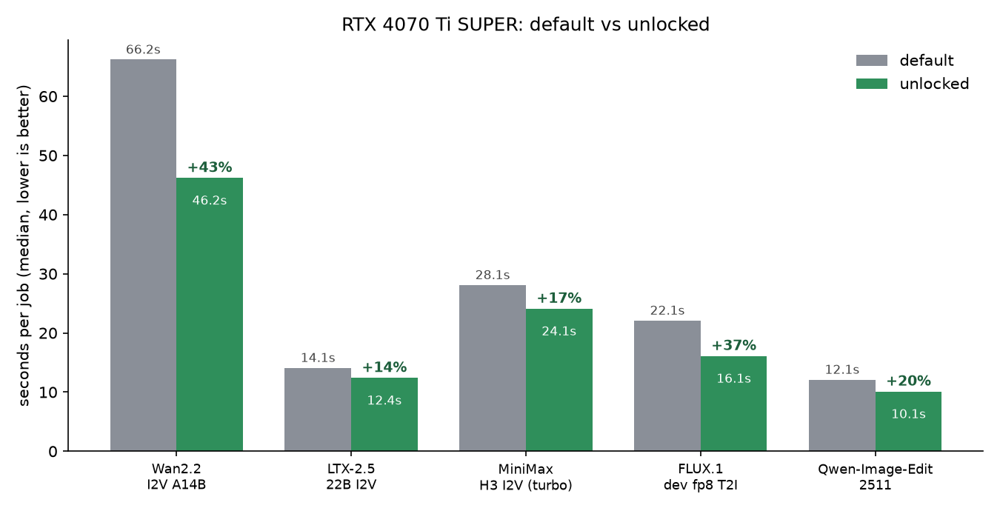

# Benchmarks: RTX 4070 Ti SUPER, default vs. unlocked, on ComfyUI workloads

Same GPU, same drivers, same models, same seeds: default state versus the unlock applied. Five ComfyUI workloads (three video models, one image model, one image-edit model).



## Summary

Median seconds per job, warm models (lower is better). Speedup = default time / unlocked time - 1.

| Workload | Default | Unlocked | Time saved | Speedup |
|---|---:|---:|---:|---:|
| Wan2.2 I2V A14B (Q4_K_S GGUF, 4-step LoRA), 832x480, 49 frames | 66.2 s | 46.2 s | -30% | **+43%** |
| FLUX.1 dev fp8, 1024x1024, 20 steps | 22.1 s | 16.1 s | -27% | **+37%** |
| Qwen-Image-Edit 2511 (fp8 + 4-step LoRA), ~1 MP | 12.1 s | 10.1 s | -17% | **+20%** |
| MiniMax H3 I2V (turbo, 6 steps), 832x480, 56 frames | 28.1 s | 24.1 s | -14% | **+17%** |
| LTX-2.5 22B distilled int8 I2V, 832x480, 49 frames | 14.1 s | 12.4 s | -12% | **+14%** |

- **The output is bit-identical.** Every default/unlocked pair used the same seed, and all frames matched exactly (mean absolute pixel difference 0.0). The unlock changes speed, not results.
- **Gains vary a lot by workload** (+14% to +43%). The two heaviest matmul workloads (Wan2.2 and Flux) gained the most.
- The speedup is not explained by clocks: the average SM clock under load was within about 2-3% between states (see [GPU telemetry](#gpu-telemetry-while-busy)).

## What was tested

| | |
|---|---|
| GPU | NVIDIA GeForce RTX 4070 Ti SUPER, 16 GB, PCIe Gen 2 x16 reading at idle |
| vBIOS / power | stock vBIOS `95.03.45.80.07`, power limit 285 W (= default) in **both** states |
| Driver | 621.14 |
| CPU / RAM / OS | Intel Core i7-14700K, 64 GB, Windows 11 Pro |
| Software | ComfyUI Desktop, PyTorch 2.13.0+cu130, Python 3.12.11 (see the [caveat](#caveats) on the ComfyUI core version) |
| Unlock | in-house modified build of [JustAResearcher/gpu-unlock-ada](https://github.com/JustAResearcher/gpu-unlock-ada). The Windows/UEFI port in [`windows/ad103-z790`](../../../../windows/ad103-z790/README.md): a cold-boot transaction that sets the SS0/SS1 tensor-core selector registers before Windows starts. No driver or VBIOS file is modified. |

### Workloads (identical graphs in both states)

| Script | Model files | Settings |
|---|---|---|
| `wan_bench.py` | Wan2.2-I2V-A14B High/LowNoise Q4_K_S GGUF, `lightx2v` 4-step LoRAs, umt5_xxl fp8, wan 2.1 VAE | 832x480, 49 frames, 4 steps (2 high + 2 low, euler/simple, cfg 1), start image: a 2K illustration |
| `ltx_bench.py` | `ltx-2.5-22b-distilled-transformer-comfy-int8-convrot`, gemma4-12b text encoder, LTX 2.5 video/audio VAEs | 832x480, 49 frames at 24 fps, 8 distilled sigmas, euler, joint video+audio latent |
| `minimax_bench.py` | `minimax_h3_fl2va_pruned_int8_convrot`, `minimax_h3_fl2v_turbo_8step` LoRA, qwen3vl 32B int8 text encoder, H3 video VAE | 832x480, 56 frames at 24 fps (the model's frame grid is 17k+5), 6 steps res_multistep |
| `flux_bench.py` | `flux1-dev-fp8` checkpoint | 1024x1024, 20 steps, euler/simple, FluxGuidance 3.5, batch 1 |
| `qwen_bench.py` | `qwen_image_edit_2511_fp8mixed`, `Qwen-Image-Edit-2511-Lightning-4steps` LoRA, qwen 2.5 VL 7B fp8 | edit a 1 MP image, 4 steps, euler/simple, cfg 1 |

### Method

1. ComfyUI started fresh, GPU idle, nothing else using it.
2. For each workload: one **untimed warm-up** job so all models are loaded, then 3 (video) or 5 (image) **timed jobs**, run back to back through the ComfyUI HTTP API.
3. Run *N* uses seed `20261109 + N` (so ComfyUI's result cache is never hit), and run *N* is identical between the default and unlocked states.
4. Time per job = wall-clock from queueing the prompt to history showing completion (includes sampling, VAE decode and saving frames, not video encoding).
5. A 1 Hz `nvidia-smi` logger records SM/memory clocks, power, temperature, utilisation and VRAM during every set.
6. Headline numbers use the **median** timed run.

## Raw timings (seconds per job)

| Workload | State | Run 1 | Run 2 | Run 3 | Run 4 | Run 5 | Median | Mean |
|---|---|---:|---:|---:|---:|---:|---:|---:|
| Wan2.2 | default | 66.2 | 66.1 | 66.2 | | | 66.2 | 66.2 |
| Wan2.2 | unlocked | 66.3 | 46.2 | 46.2 | | | 46.2 | 52.9 |
| LTX-2.5 | default | 14.1 | 14.0 | 14.1 | | | 14.1 | 14.1 |
| LTX-2.5 | unlocked | 14.0 | 12.4 | 12.4 | | | 12.4 | 12.9 |
| MiniMax H3 | default | 28.1 | 28.1 | 28.1 | | | 28.1 | 28.1 |
| MiniMax H3 | unlocked | 24.1 | 24.1 | 22.2 | | | 24.1 | 23.5 |
| FLUX.1 dev | default | 28.2 | 22.1 | 22.1 | 22.1 | 22.1 | 22.1 | 23.3 |
| FLUX.1 dev | unlocked | 16.0 | 16.0 | 16.1 | 16.1 | 16.1 | 16.1 | 16.1 |
| Qwen-Image-Edit | default | 12.1 | 12.0 | 12.1 | 12.1 | 12.1 | 12.1 | 12.1 |
| Qwen-Image-Edit | unlocked | 10.1 | 10.1 | 10.1 | 10.0 | 10.0 | 10.1 | 10.1 |

Notes on individual runs:

- **Unlocked Wan2.2 run 1 (66.3 s)** was cold: that was the first run after the models were loaded from disk, so it is not a like-for-like timing. Runs 2 and 3 are warm. The default-state Wan set had an untimed warm-up first, so all three of its runs are warm.
- **Default FLUX run 1 (28.2 s)** is slower than the other four (22.1 s) even after the warm-up; it is excluded by using the median.
- **Unlocked LTX run 1 (14.0 s)** is slower than runs 2-3 (12.4 s); it matches the default's time, so the unlock's gain only appears from run 2 on in that set. The cause was not investigated. If run 1 is counted, the LTX mean speedup is +9%.
- **MiniMax** is the noisiest: the unlocked set is 24.1 / 24.1 / 22.2 s. The median speedup is +17%; the mean speedup is +20%.
- Using means instead of medians gives: Wan +25% (it counts the cold run 1), LTX +9%, MiniMax +20%, FLUX +45% (counts the slow default run 1), Qwen +20%.

## GPU telemetry while busy

Average over the samples with GPU utilisation above 90%. Clocks and power are close between states; the unlocked runs draw slightly more power on some workloads.

| Workload | State | SM clock | Power | Max temp | Peak VRAM |
|---|---|---:|---:|---:|---:|
| Wan2.2 | default | 2912 MHz | 228 W | 71 C | 13.9 GB |
| Wan2.2 | unlocked | 2811 MHz | 237 W | 73 C | 14.4 GB |
| LTX-2.5 | default | 2920 MHz | 193 W | 67 C | 15.2 GB |
| LTX-2.5 | unlocked | 2924 MHz | 204 W | 66 C | 15.3 GB |
| MiniMax H3 | default | 2878 MHz | 227 W | 71 C | 15.2 GB |
| MiniMax H3 | unlocked | 2858 MHz | 233 W | 70 C | 15.2 GB |
| FLUX.1 dev | default | 2915 MHz | 222 W | 72 C | 15.3 GB |
| FLUX.1 dev | unlocked | 2863 MHz | 248 W | 71 C | 14.7 GB |
| Qwen-Image-Edit | default | 2896 MHz | 223 W | 70 C | 15.4 GB |
| Qwen-Image-Edit | unlocked | 2902 MHz | 223 W | 68 C | 15.3 GB |

The raw 1 Hz logs are in [`results/`](results/) (`gpu_*.csv`).

## Caveats

Read these before quoting the numbers.

1. **ComfyUI core version differs between states.** The unlocked runs were measured on ComfyUI 0.44.x; the default-state runs afterwards were measured on **ComfyUI 0.45.1** (the core and frontend were updated on 2026-11-10 between the two sets). PyTorch (2.13.0+cu130), the driver, the models and the graphs were unchanged, and the outputs are bit-identical, so the difference is unlikely to matter, but it is a confound. Re-running the unlocked set on 0.45.1 would close it.
2. **Order effect.** The unlocked set was measured first and the default set later in the same day; a thermal or background-load difference cannot be ruled out, though run-to-run variance within each set was very small (typically within 0.1 s).
3. **One GPU, one machine, one day.** Short jobs, fixed seeds, no repeats of the whole procedure.
4. **A modified-vBIOS Wan2.2 run** was taken first (62.2 s, raised power limit) and is **not** used as the baseline. The default-state number above (66.2 s) is on the stock vBIOS, the same as the unlocked runs.
5. **SeedVR2 was not benchmarked.** It was started (3B fp16, 49 frames to 1728x960) but stalled with VRAM full and was aborted, so there are no results for it.
6. The workloads are specific quantisations (GGUF Q4_K_S, int8, fp8). Other precisions may respond differently.
7. Times exclude model loading except where marked (cold run 1).
8. **Start image.** The Wan, LTX and MiniMax runs and the Qwen edit all start from `assets/bench_start.png` (2048x1152). The original image is not included in this repository; `scripts/make_start_image.py` generates a stand-in of the same size, and any 2048x1152 image works. Compute cost should not depend on image content, but the published timings were taken with the original, so expect close, not identical, numbers.

## Reproduce

Requirements: ComfyUI with the node packs for each model (GGUF loader, LTX, MiniMax H3), the model files listed above, Python 3 (standard library only for the benchmark; `build_report.py` also needs matplotlib, `diff_outputs.py` needs pillow + numpy), and `nvidia-smi` on PATH for the GPU log. Run everything from the repository root.

```bash
# create assets/bench_start.png first: any 2048x1152 image works, or run scripts/make_start_image.py for a stand-in
python scripts/preflight.py                 # which workloads can run here (nodes + model files)

# run the whole suite once per state, same ComfyUI start each time (one fresh start per state):
python scripts/run_bench_set.py default     # 5 workloads: untimed warm-up, then 3 (video) / 5 (image) timed jobs
# ... change the state (apply the unlock, new driver, ...), restart ComfyUI ...
python scripts/run_bench_set.py unlocked

python scripts/compare_all.py default unlocked          # median speedup per workload + environment-drift warning
python scripts/diff_outputs.py <comfy_output_dir> wan_default wan_unlocked   # pixel diff of same-seed outputs (0.0 = identical)
python scripts/build_report.py default unlocked         # regenerates charts/speedup.png and results/summary.json
```

`run_bench_set.py <label>` writes `results/env_<label>.json` (ComfyUI, PyTorch, driver, GPU, vBIOS, power limit, OS), then `results/results_<workload>_<label>.json` and `results/gpu_<workload>_<label>.csv` for `wan`, `ltx`, `mm_turbo`, `flux`, `qwen`. `compare_all.py` warns if ComfyUI, PyTorch, the GPU or the power limit differ between the two labels, which is exactly the confound described in caveat 1. A single workload can be run on its own, for example `python scripts/wan_bench.py wan_mylabel 3` (set `BENCH_WARMUP=1` for the untimed warm-up).

Environment variables: `BENCH_HOST` (default `http://127.0.0.1:8188`), `BENCH_DIR` (default `./results`), `BENCH_START_IMG` (default `./assets/bench_start.png`).

## Files

```
README.md                  short overview
BENCHMARKS.md              this report
charts/speedup.png         summary chart
assets/bench_start.png     not shipped; create with scripts/make_start_image.py (2048x1152)
results/summary.json       medians, means and GPU stats per workload
results/results_<workload>_<state>.json   per-run timings (workload = wan | ltx | mm_turbo | flux | qwen, state = default | unlocked)
results/gpu_<workload>_<state>.csv        1 Hz GPU telemetry for every set
results/state_default.txt  nvidia-smi snapshot of the default state
scripts/                   harness, workloads, preflight, runner, compare, pixel-diff, report builder
```

The result files for this report were recorded with the earlier per-script commands (before `run_bench_set.py` existed) and renamed to the `<workload>_<state>` scheme; their contents are unchanged except the `label` field. They have no `env_*.json` files, so `compare_all.py` skips its drift check for them.
