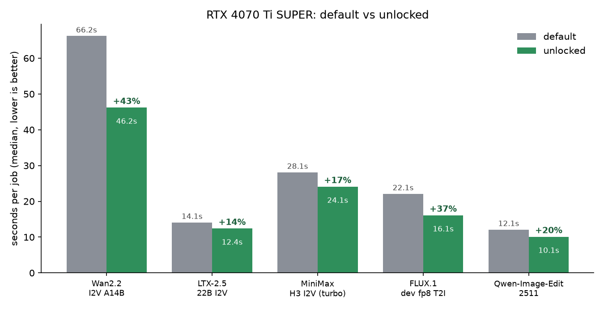

# ComfyUI GPU benchmarks: default vs. unlocked (RTX 4070 Ti SUPER)

A small, repeatable benchmark suite for a local [ComfyUI](https://github.com/comfyanonymous/ComfyUI), plus the results of running it on an RTX 4070 Ti SUPER in its default state and with an unlock applied.



Median seconds per job, warm models, same seeds and settings (speedup = default / unlocked - 1):

| Workload | Default | Unlocked | Speedup |
|---|---:|---:|---:|
| Wan2.2 I2V A14B (Q4_K_S GGUF), 832x480, 49 frames | 66.2 s | 46.2 s | **+43%** |
| FLUX.1 dev fp8, 1024x1024, 20 steps | 22.1 s | 16.1 s | **+37%** |
| Qwen-Image-Edit 2511 (fp8 + 4-step LoRA), ~1 MP | 12.1 s | 10.1 s | **+20%** |
| MiniMax H3 I2V (turbo), 832x480, 56 frames | 28.1 s | 24.1 s | **+17%** |
| LTX-2.5 22B distilled int8 I2V, 832x480, 49 frames | 14.1 s | 12.4 s | **+14%** |

Outputs are bit-identical between the two states (same seed, mean absolute pixel difference 0.0). Read the caveats in [BENCHMARKS.md](BENCHMARKS.md) before quoting any number; in particular the ComfyUI core version differed between the two measured sets.

## Run it on your machine

Needs ComfyUI with the node packs and model files for each workload (see [BENCHMARKS.md](BENCHMARKS.md)), Python 3, and `nvidia-smi`. From the repository root:

```bash
python scripts/preflight.py              # shows which workloads can run on this ComfyUI
python scripts/run_bench_set.py default  # run the suite for one state; repeat with another label after changing something
python scripts/compare_all.py default other
```

Each run records the ComfyUI / PyTorch / driver / GPU / power-limit environment, and `compare_all.py` warns when two labels differ in any of them, so a software update between states is not silently mistaken for a hardware effect.

## Layout

- [`BENCHMARKS.md`](BENCHMARKS.md): full report (setup, method, raw timings, GPU telemetry, caveats, reproduction steps)
- `scripts/`: harness, workload scripts, preflight, runner, compare, pixel-diff, report builder
- `results/`: per-run timings, 1 Hz GPU telemetry, summary
- `charts/`, `assets/`
